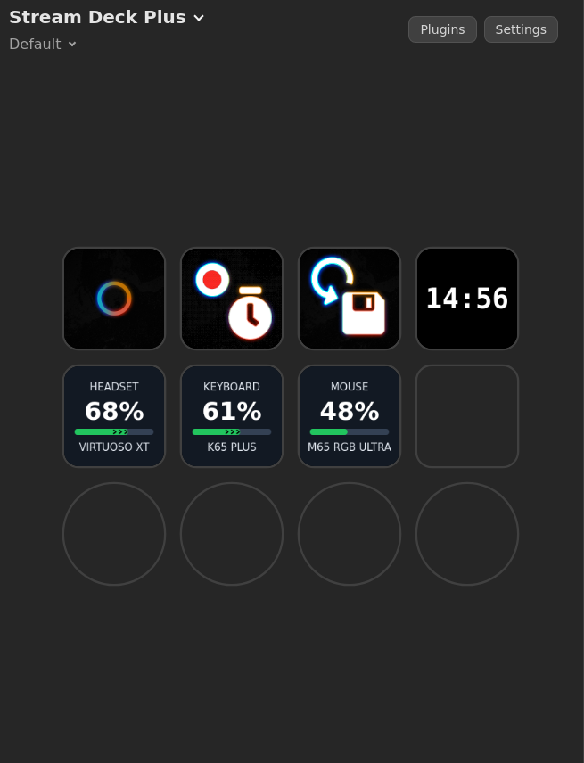

# OpenLinkHub-deck

An **unofficial, open-source OpenDeck plugin** for Linux x86-64 that displays battery levels of supported Corsair wireless devices using the [OpenLinkHub](https://github.com/jurkovic-nikola/OpenLinkHub) API.

Built in Go, with no Node.js runtime required.

> **Disclaimer:** This is an unofficial community project and is not affiliated with, sponsored by, or endorsed by OpenLinkHub, OpenDeck, or Corsair.

## Features

- Battery percentage display for supported Corsair wireless devices
- Estimated charging indicator using black chevrons
- Customizable device name and device type
- Adjustable font sizes and label positions
- Configurable OpenLinkHub IP address and port
- Automatic "Device Offline" display

### Charging Indicator

The plugin estimates charging activity by detecting increases in the battery percentage reported by OpenLinkHub.

After an increase, black chevrons may appear inside the battery bar for up to 10 minutes.

**Important:** This is only an estimate, not actual charging-state detection. Battery reports may be delayed or inaccurate. The indicator resets when the plugin restarts and is not shown at 100%.

## Requirements

- Linux x86-64
- OpenDeck
- OpenLinkHub with its HTTP API accessible

Default API address: `127.0.0.1:27003`

## Installation

1. Download `OpenLinkHub-deck-1.1.2.zip` from the [Releases](../../releases) page.
2. Open OpenDeck.
3. Select **Install from file**.
4. Choose the downloaded ZIP archive.
5. Add the **OpenLinkHub Battery** action to a Stream Deck key.
6. Select your device and customize the display.

Make sure OpenLinkHub is running and its API is accessible.

## AI-Assisted Development

**This plugin was developed with the assistance of OpenAI's ChatGPT.**

AI assistance was used for code generation, implementation, debugging, testing, and documentation.

The plugin was tested by the project maintainer on a Linux system running OpenDeck and OpenLinkHub.

AI-generated code can contain mistakes. Bug reports, code reviews, and contributions are welcome.

## License

This project is licensed under the **MIT License**.

See the [LICENSE](LICENSE) file for the complete license text.

The license applies to project content for which the copyright holder has the necessary rights. Third-party names, trademarks, and assets remain subject to their respective owners' rights.

## Tested Environment

OpenLinkHub-deck v1.1.2 has been tested with the following environment:

- **Operating System:** Bazzite 45 (KDE)
- **OpenDeck:** 2.14.2 (Flatpak)
- **OpenLinkHub:** 0.9.4 (inferred from binary build paths)
- **Architecture:** Linux x86-64
- **API endpoint:** `http://127.0.0.1:27003/api/systray`
- **Stream Deck:** Stream Deck Plus

Compatibility with other OpenLinkHub versions, Linux distributions, and Stream Deck models has not yet been verified.

## Disclaimer

OpenLinkHub-deck is an independent, unofficial community project.

It is not affiliated with or endorsed by:

- OpenLinkHub
- OpenDeck
- Corsair

All product names and trademarks belong to their respective owners.
